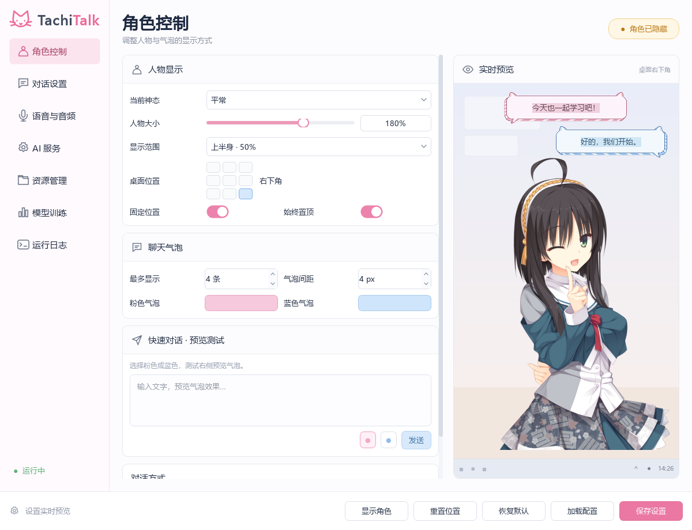
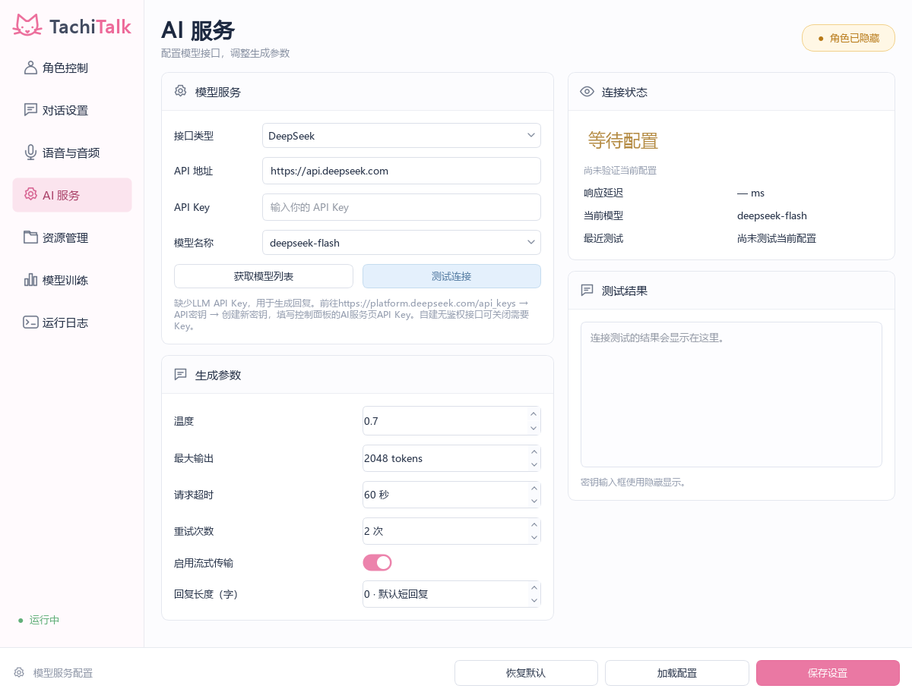
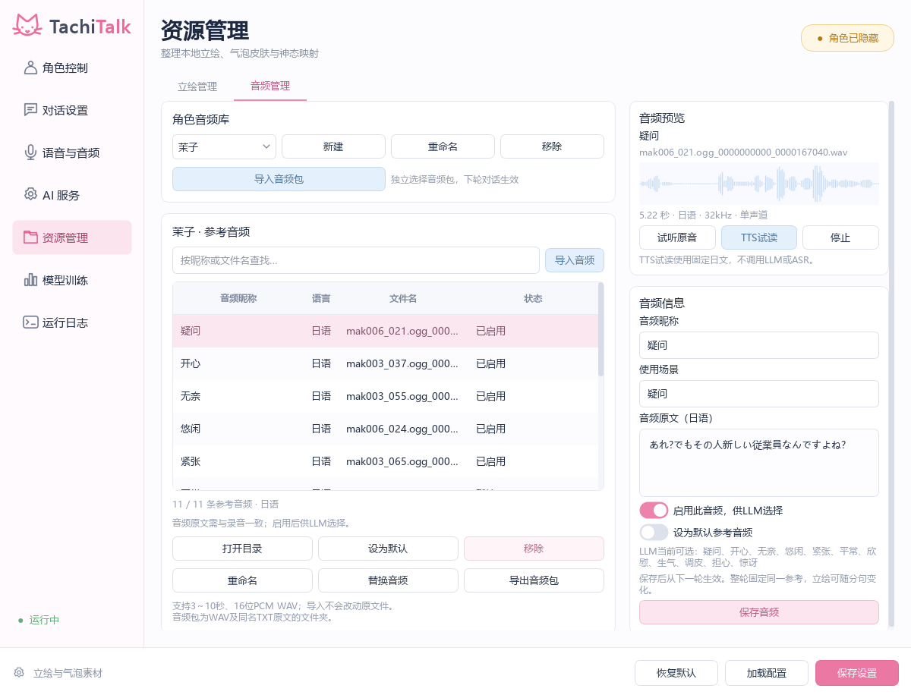

<div align="center">

# TachiTalk

**会听、会说，也会用表情回应你的语音桌宠。**

日语角色配音 · 中文字幕 · 可管理的立绘与参考音频 · Windows 桌面控制面板

<p>
  <a href="LICENSE"></a>
  
  
  <a href="https://github.com/maruyui-dev/TachiTalk/releases"></a>
  <a href="https://github.com/maruyui-dev/TachiTalk/stargazers"></a>
</p>

[下载运行包](https://github.com/maruyui-dev/TachiTalk/releases) · [报告问题](https://github.com/maruyui-dev/TachiTalk/issues) · [协议与第三方资源](THIRD_PARTY_NOTICES.md)

</div>



## 能做什么

- **语音与文字对话**：持续监听 → VAD → ASR → LLM → TTS → 播放，也可直接输入文字。
- **边生成边朗读**：LLM 分段输出日语语音文本与气泡正文，合成和播放使用有界流水线。
- **自然连贯的角色表现**：整轮回复共用一种参考语音情绪，立绘神态可随分句变化。
- **自定义资源**：立绘与参考音频分别管理；支持音频导入、替换、改名、停用及默认音频选择。LLM 使用当前启用的昵称，TTS 使用对应录音。
- **可调生成参数**：支持 DeepSeek、OpenAI 兼容和自定义接口，配置模型、温度、token 上限及 **0～2000 字回复长度偏好**。
- **记住上次设置**：正常关闭时自动保存界面、服务配置、角色位置与显示状态，启动时恢复；自动配置使用当前 Windows 用户的 DPAPI 加密。
- **本地 TTS 自动管理**：自动加载 GPT-SoVITS v2ProPlus；退出时清理自己启动的服务，复用用户服务时不接管其生命周期。

> 模型训练页目前是界面预览，尚未接入训练流程。回复字数属于生成偏好，可能存在偏差；0 沿用默认短回复。较长回复还需要足够的 token 预算。

<details>
<summary>查看 AI 服务与参考音频管理界面</summary>





</details>

## 下载与启动

面向普通用户，请下载 [Releases](https://github.com/maruyui-dev/TachiTalk/releases) 中的**完整 Windows 运行包**。GitHub 自动生成的 Source code 压缩包不含推理运行库和模型，不能当作完整运行包。

1. 下载同一版本的全部分卷及 `合并完整包.cmd`，放在同一个文件夹。双击脚本生成 `TachiTalk.zip`。Release 附件受单文件大小限制，因此采用分卷分发。
2. 完整解压 ZIP，进入 `TachiTalk` 文件夹，双击 `TachiTalk.exe`。不要直接在压缩包中启动，也不要只复制 EXE。
3. 在 **AI 服务**中填写自己的接口地址、API Key 和模型。使用语音输入时，再在 **语音与音频**中配置 ASR；只用文字对话无需 ASR Key。
4. 首次启动需要加载本地语音模型并静默预热，观察运行日志确认就绪。随后可输入文字，或按录音开关使用语音输入。

运行包包含客户端运行环境、GPT-SoVITS 私有推理环境、选定模型、立绘和参考音频，无须安装系统 Python 或 CUDA Toolkit。NVIDIA 显卡驱动需由用户安装。

关闭控制面板会退出程序；隐藏角色或单独关闭角色窗口会保留控制面板。

## 系统与兼容性

| 项目 | 要求与验证范围 |
| --- | --- |
| 操作系统 | Windows 10 2004（19041）及以上、Windows 11，64 位；本轮实机为 Windows 11 22631 |
| 客户端 | Python 3.12 / PySide6；完整运行包已内置 |
| 本地 TTS | GPT-SoVITS v2ProPlus，独立 Python 3.9.13，PyTorch 2.7.1 + CUDA 12.8 |
| NVIDIA GPU | 启动时实际验证 FFT、复数运算、矩阵乘和卷积；失败时给出原因并使用 CPU 全精度 |
| RTX 50 系 | 自带库包含 `sm_120`，采用支持 Blackwell 的 CUDA 12.8 构建；尚未完成 RTX 50 实机验收 |
| 无可用 CUDA | 可使用 CPU 兼容模式，模型加载及合成会更慢 |
| 网络 | 在线 LLM / ASR 需要联网及用户自己的账号；本地 TTS 无需付费 API |

请为解压后的完整推理环境预留约 **12 GB** 空间，并额外保留下载压缩包的空间。本轮实机 GPU 为 RTX 4060 Laptop；Windows 10 与 RTX 50 的实机结果不应由此推断。相关依据：[PyTorch 2.7 Blackwell 支持](https://pytorch.org/blog/pytorch-2-7/)、[Qt Windows 支持](https://doc.qt.io/qt-6.12/windows.html)。

GPU 模式建议使用 **Windows 10 22H2**，或 NVIDIA 支持表列出的 Windows 11 版本；CUDA 12.8 的官方 Windows 表列有 Win10 22H2、Win11 22H2 / 23H2 / 24H2。程序的安装下限不代表较早的 Windows 10 版本已通过 CUDA 验收，详见 [NVIDIA 系统要求](https://docs.nvidia.com/cuda/archive/12.8.0/cuda-installation-guide-microsoft-windows/index.html)。

## 配置与数据

- 运行包的配置、日志和导入资源位于 `%LOCALAPPDATA%\TachiTalk`；源码运行时位于项目的 `_qt_runtime_tmp`。
- 自动恢复文件只适用于同一 Windows 用户。跨设备迁移请使用面板中的“保存设置 / 加载配置”，并保管好导出的配置文件。
- **手动导出的配置包含密钥**，不要上传到仓库、Issue 或公开网盘。运行包不包含作者的本地配置、聊天记录和 API Key。
- 参考音频使用 3～10 秒、16 位 PCM WAV，填写与录音对应的日语原文；错误原文或不匹配录音会影响声音效果。
- 在音频管理中保存改名、启用状态或默认音频后，新一轮 LLM 与 TTS 会使用新快照；进行中的回复保留原参考，避免半途变声。
- 面板内的下拉框和数值输入框不会因滚轮经过而改变值。

## 从源码运行

```powershell
git clone https://github.com/maruyui-dev/TachiTalk.git
cd TachiTalk
py -3.12 -m venv .venv
& .\.venv\Scripts\python.exe -m pip install -r requirements.txt
& .\.venv\Scripts\python.exe -B main.py
```

源码仓库不跟踪数 GB 的推理运行库与模型。若需本地 GPT-SoVITS，将完整包中的 `services\gpt_sovits` 放入同名目录；所需文件见 `services/gpt_sovits/distribution.json`。不要把推理依赖安装到系统 Python，也不要用旧版 CUDA / PyTorch 覆盖项目自带环境。

公开仓库采用当前版本的干净源码快照，各文件附独立提交说明；开发机的原始历史与 `stable-2026-10-22` 稳定标签另行保留。超分辨率权重和第三方训练数据清单随完整包保留，不放进普通 Git 历史。

```text
app/audio/                  采集、VAD、设备与播放
app/core/                   对话调度、运行配置、历史与资源库
app/services/               LLM、ASR、TTS 客户端与本地服务生命周期
app/ui/                     控制面板、角色与气泡
resources/control_panel/    Designer .ui 与样式
assets/                     立绘、气泡与参考音频
services/gpt_sovits/        独立推理服务（运行库与权重不进 Git）
scripts/                    启动、性能测量与发行构建
tests/                      单元、Qt 与本地协议测试
```

## 验证与性能

在项目虚拟环境中执行测试，不启用麦克风、不调用付费 LLM / ASR：

```powershell
& .\.venv\Scripts\python.exe -B -m unittest discover -s tests -v
```

固定日文、本地 TTS 测量（可选；会加载模型）：

```powershell
& .\.venv\Scripts\python.exe -B scripts/benchmark_tts.py --launch --runs 4 --check-recovery --output scratch/tts-check
```

已有同机对照数据见 [TTS 测量记录](recovery/tts_latency_2026-10-22.json)。RTX 4060 Laptop 的已加载模型测量中，首次 PCM 中位数为 **0.544 → 0.505 秒**，首次写播放设备为 **0.669 → 0.563 秒**，完整合成为 **1.714 → 1.376 秒**。冷进程的首次请求受静默预热改善，但模型加载阶段仍需等待；这些数值不代表所有电脑的表现。首次写设备时间包含软件预缓冲，未使用声学回环测量实际扬声器出声。

## 反馈与贡献

欢迎通过 [Issues](https://github.com/maruyui-dev/TachiTalk/issues) 提交复现步骤、Windows 版本、GPU 型号、驱动版本及已脱敏的日志。请注明问题发生在首次加载还是模型就绪后，并移除密钥、私人对话和个人路径。

提交 PR 时说明改动目的与测试结果；界面优先修改 Designer `.ui`，保留原有立绘、气泡与语音规则。兼容性问题请附上实际硬件结果。

## 许可证与致谢

TachiTalk 原创代码使用 [MIT License](LICENSE)。第三方依赖、预训练模型、茉子立绘、参考录音及角色语音权重保留各自权利，**不因本项目使用 MIT 而自动获得再授权**；详见 [第三方说明](THIRD_PARTY_NOTICES.md)。

感谢 [GPT-SoVITS](https://github.com/RVC-Boss/GPT-SoVITS)、[Qt for Python](https://doc.qt.io/qtforpython-6/)、[PyTorch](https://pytorch.org/) 及相关开源项目。

## Star History

<p align="center">
  <a href="https://www.star-history.com/#maruyui-dev/TachiTalk&amp;Date">
    <picture>
      <source media="(prefers-color-scheme: dark)" srcset="https://api.star-history.com/svg?repos=maruyui-dev/TachiTalk&amp;type=Date&amp;theme=dark">
      <source media="(prefers-color-scheme: light)" srcset="https://api.star-history.com/svg?repos=maruyui-dev/TachiTalk&amp;type=Date">
      
    </picture>
  </a>
</p>

星标与历史图由 GitHub / Star History 动态提供，新仓库可能暂时没有曲线。
